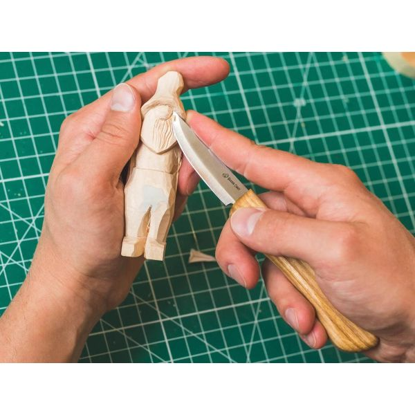

I've never considered myself a "creative". I've gone as far as to identify as the opposite.
I don't really know what the word for that is but I always said I was a "computer guy" and
the tangible "arts" just weren't for me. I knew since the 6th grade that my career was going
to involve _something_ with computers. There was just a way that my mind connected with
computer interfaces that felt so much more natural than anything else in the world.
Everything else I tried just felt... Unintuitive.

I say this to the degree that I took my high school's "Art 101" as an elective and was so
overwhelmed with my lack of ability to visualize or ideate what I should be doing that this
would end up becoming my first class I had ever dropped after being tasked to "draw
anything you would like". I tried branching out to metal working and wood working and while
they were _doable_ they always felt much harder than anything I'd ever done involving
technology. I think that's why I've always been so drawn to my homelabbing endeavors and
trying to make the most irresponsible and crazy ideas I can imagine come to life.

As an adult I've managed to force myself out of my comfort zone and to grow into other areas
that were completely unapproachable to me before. A few years ago I became a first time
homeowner and found myself thrown into the deep end of becoming a DIYer as someone who's too
cheap to pay someone else to do work I can do myself (with the advice and guidance of my
father who is a skilled tradesman).

Taking on this new stage of my life where I'm forced to be more creative and come up with
solutions I can fabriacte to solve problems in my home I've started to reflect more on what
the creative mind really entails and why it felt so alien to me my whole life. The more I
worked with my hands and became comfortable with simple woodworking and electrical the more
I started to gain a new appreciation for my profession as a creative profession rather than a
purely "engineering" or "mathematical" practice.

When people think of software engineering they tend to have this idea that it's always a
predictable and deterministic or mathematical endeavor. While this is certainly true for
some I've never really worked with code in this way. I've never been much of a LeetCoder or
someone who memorized the most efficient algorithms and patterns.

I don't think of my code bases as inputs and outputs. Instead they take their own
undescribable "shape" in my head where I think about the logic flow as a contour or rounded
edge that you can trace your finger over and feel the groove of where you're headed.
I imagine the little pieces of technical debt left behind as little pimples or gouges in
the "material" that can be filled, chiseled, or sanded away with patience.

I think of it how I imagine a whittler who has a piece cut down to 70% or so of the final
shape thinks of their creation. You can tell just by looking at it what you're going for but
you can still see the coarse cuts at the base that haven't received enough attention to have
a decipherable shape yet. Or around the top where the artist has really spent the most time
and you can see exactly what their vision is and the idea is conveyed to you in completeness.

I may have a really solid piece of logic in one place but I know somewhere else that feeds
into this good piece of logic I have the coarse cut "legs" that hasn't quite taken their
final shape yet.
When I get around to refactoring it or doing whatever is needed to make it "nice" I get
that hit of dopamine that same way you would when you finish a painting and set your brush
down and can soak in the conclusion of your vision becoming physical and tangible.

For me code has always been the material I'm most comfortable working with. I can imagine
what my "brush strokes" in my text editor will do and how it will change the overall shape of
the project. When I think about how I'm going to solve a problem I can see the "vision" of
where I'm trying to get. I don't know _exactly_ what "paints" I'll have to mix or how I'll
have to apply them to get to that final destination but I have the vision in my head of what
it should feel like. Everything beyond that is the patient chiseling of material. Knocking off
huge slabs here, sanding tiny layers off over there, and lots of staring at it and wondering
how I am possibly going to get to where I'm trying to go.

I still can't draw or express myself in "visually pleasing" ways to this day. I would say
it's actually ironic that so much of how I try to express my relationship with code is through
this visual model because I actaully can't see anything in my mind's eye. This is
called "aphantasia" and means I can't voluntarily visualized mental images. But when I think
of code it's like I, for a lack of a better word, "feel" the shape of it inside me.

When I get something working just the way I want it to, exactly how I imagined, its the same
feeling as when you make something out of wood and design it to fit in a space and when you
finish it you watch the piece slide into place perfectly. It comes with a sense of relief
where your shoulders feel just a little lighter now that you can enjoy the final product
and that although you maybe didn't know how it would come out in the end you now know it came
out right. I know every time I right a new piece of code and finally get it completed I can't
help but run it a dozen times watching the same inputs turn into the same outputs in the same
amount of time while grinning like a child who just got python to say "Hello $YOUR_NAME!" for
the first time.

I know this may seem like I've been leading you down a pointless train of thought through
this entire post. And I'd have to agree and say that you're right. I don't think I really
have a real point or conclusion I'm drawing you towards per se. To me this is an attempt to
express an idea I feel deeply attached to that I find hard to connect others with.

The "point" if I had to come up with one would be that some software engineers consider themselves to be strictly mathematical in their work but I propose that there are parallels to be
drawn between the art and software engineering. The process of taking your rough material and
molding it into something that was previously only an idea in your head. It's almost romantic
in it's own quirky way. I'm not the first person to have this revelation by a long shot but
this was my attempt to convey and share what that sentiment means to me personally.
